# OpenOrbit

> An AI-powered open-source contribution assistant designed to bridge the gap from discovering a real GitHub issue to submitting a high-quality Pull Request.


---

## 📌 Why OpenOrbit?

Contributing to unfamiliar open-source codebases introduces significant cognitive friction:
- Developers struggle to navigate massive repositories and identify the exact source files requiring modification.
- Generic LLM prompts hallucinate non-existent files or ignore existing repository architecture conventions.
- Context is fragmented across issue trackers, README files, Git histories, and manual test setups.
- Drafting conventional commit pull requests, testing checklists, and risk assessments requires repetitive effort.

**OpenOrbit** unifies real-time GitHub issue discovery, repository context extraction, AI-driven contribution roadmaps, and verified fact separation into a cohesive, secure developer workspace.

---

## ⚡ Core Experience

### Issue Discovery & Catalog
Query live GitHub issues filtered by beginner-friendly labels (`good-first-issue`, `help wanted`), languages, and keyword searches via real-time GitHub REST integration with built-in rate-limit awareness and pagination.

### Repository Inspector
Inspect verified repository metadata, license details, star/fork counts, default branch information, recent commits, open pull requests, and raw README context before committing to work.

### AI Contribution Planner
Synthesize structured, actionable contribution roadmaps powered by **Google Gemini** (cloud primary) or **Ollama** (offline local fallback). Each plan includes identified target files, step-by-step implementation sequences, dependencies & risks, acceptance criteria, and concrete test plans.

### Verified Facts vs. AI Suggestions
OpenOrbit enforces strict grounding: repository files confirmed through repository context or MCP tool inspection are explicitly flagged as `verified`, distinguishing concrete repository facts from proposed AI suggestions.

### Review, Approval & PR Drafting
Automatically generate conventional commit PR titles (`fix(scope): ...`) and structured Markdown summaries with populated verification checklists. Consequential mutating operations are gated behind cryptographically signed HMAC-SHA256 action approval tokens.

### Saved Issues & Personalized Recommendations
Manage a user-scoped contribution backlog in MongoDB with custom implementation notes and lifecycle statuses (`saved`, `in_progress`, `completed`, `dismissed`). OpenOrbit analyzes saved issue tags to automatically suggest new beginner-friendly issues tailored to your preferred languages.

---

## 🏗️ System Architecture

```mermaid
---
config:
  theme: base
  themeVariables:
    background: '#faf8f2'
    primaryColor: '#ffffff'
    primaryTextColor: '#292824'
    primaryBorderColor: '#55534b'
    secondaryColor: '#edf2e9'
    secondaryTextColor: '#292824'
    secondaryBorderColor: '#47634a'
    tertiaryColor: '#f5e9cc'
    tertiaryTextColor: '#292824'
    tertiaryBorderColor: '#927332'
    lineColor: '#686458'
    textColor: '#292824'
    edgeLabelBackground: '#faf8f2'
---
flowchart LR
    Website("1 · User & Authentication<br/>Public homepage<br/>React + Vite")
    DiscoveryPath("2 · Discover Repository<br/>& Gather Context<br/>Protected dashboard · Express")
    AssemblePrompt("3 · AI Contribution Planning<br/>Cloud Gemma primary<br/>Generate and validate")
    DisplayPlan("4 · Review & Approval<br/>Review plan or proposed action")
    Outcome("5 · Result & Persistence<br/>Dashboard: plan or confirmed result<br/>Pending / cancelled / failed")
    GHOAuthFlow("GitHub OAuth via Express<br/>Establish and verify session<br/>Failure: remain at sign-in")
    ContextAssembly["GitHub REST API<br/>GitHub MCP server · stdio<br/>Python FastAPI · when applicable"]
    LocalRequest["Cloud: gemma-4-26b-a4b-it<br/>Optional local: Ollama gemma2:2b<br/>Fallback support unverified"]
    ContextFailed("Safe error / recovery<br/>Context or service failure")
    UserDecision{"Explicitly<br/>approved?"}
    Execute("Express: validate approval<br/>and authorization<br/>Execute only if implemented")
    SessionStored[("MongoDB<br/>Supported user data")]
    Website -->|Valid session| DiscoveryPath
    DiscoveryPath -->|Search, select, gather| AssemblePrompt
    AssemblePrompt -->|Validated plan| DisplayPlan
    DisplayPlan -->|Advice only| Outcome
    Website -->|Sign in / expired| GHOAuthFlow
    GHOAuthFlow -->|Session verified| DiscoveryPath
    DiscoveryPath -.- ContextAssembly
    AssemblePrompt -.- LocalRequest
    DiscoveryPath -->|Insufficient context| ContextFailed
    AssemblePrompt -->|Generation failed| ContextFailed
    DisplayPlan -->|Supported action proposed| UserDecision
    UserDecision -->|Yes| Execute
    UserDecision -->|No: pending / cancelled| Outcome
    Execute -->|Backend-confirmed outcome| Outcome
    Outcome -.->|Via Express only, if implemented| SessionStored
```



---

## 🛠️ Tech Stack

- **Frontend**: React 19 (`19.2.8`), Vite 8 (`8.3.0`), Vanilla CSS Design System (Warm Neutral tokens), oxlint
- **Backend**: Node.js (v20+), Express 5 (`5.3.0`), cookie-parser, cors, dotenv
- **Database & ODM**: MongoDB, Mongoose 9 (`9.11.2`)
- **Authentication & Security**: HTTP-only JWT (`jsonwebtoken` 9.0), bcrypt password hashing (`bcryptjs` 3.0, cost 12), AES-256-GCM token encryption, RFC 7636 PKCE OAuth (`S256`), HMAC-SHA256 action approval tokens
- **AI Orchestration**: Google GenAI SDK (`@google/genai` 2.30, `gemini-2.5-flash`), Ollama HTTP API (`llama3:latest` / `gemma2:2b` fallback), XML prompt injection boundary defenses
- **Extensible Tool Protocol**: Model Context Protocol client (`@modelcontextprotocol/sdk` 1.32) over Stdio transport
- **Microservices Layer**: Python 3.11+, FastAPI (`>=0.115`), Pydantic v2, uvicorn

---

## ⚙️ Setup & Environment Configuration

### Prerequisites
- Node.js `v20.0.0+` (tested on `v22.18.0`)
- npm `10.0.0+`
- MongoDB running locally (`mongodb://127.0.0.1:27017/openorbit`) or MongoDB Atlas URI
- *(Optional)* [Google AI Studio API Key](https://aistudio.google.com/) for hosted Gemini / Gemma inference
- *(Optional)* [Ollama](https://ollama.ai/) for offline local model inference

### 1. Workspace Installation

```bash
git clone https://github.com/Neeraj-code-beep/OpenOrbit.git
cd OpenOrbit

# Install root orchestrator and tier dependencies
npm install
npm --prefix server install
npm --prefix client install
```

### 2. Backend Environment Configuration

```bash
cp server/.env.example server/.env
```

Configure `server/.env`:

| Environment Variable | Required | Purpose | Default / Example |
| :--- | :--- | :--- | :--- |
| `PORT` | No | Express server listening port | `5000` |
| `NODE_ENV` | No | Server environment mode | `development` |
| `CORS_ORIGIN` | No | Allowed frontend origin | `http://localhost:5173` |
| `CLIENT_ORIGIN` | No | Client application base URL | `http://localhost:5173` |
| `MONGODB_URI` | **Yes** | MongoDB connection string | `mongodb://127.0.0.1:27017/openorbit` |
| `JWT_SECRET` | **Yes (Prod)** | Secret key for signing session tokens | `your_long_random_jwt_secret_here` |
| `JWT_EXPIRES_IN` | No | JWT expiration window | `1d` |
| `GITHUB_TOKEN` | No | Optional GitHub PAT for higher rate limits (5,000 req/hr) | `ghp_...` |
| `AI_PROVIDER` | No | Active LLM routing provider (`gemini`, `ollama`, `none`) | `gemini` |
| `GEMINI_API_KEY` | For Gemini | Google AI Studio API Key | `your_gemini_api_key_here` |
| `GEMINI_MODEL` | No | Primary cloud model target | `gemini-2.5-flash` |
| `OLLAMA_HOST` | For Ollama | Local Ollama daemon address | `http://127.0.0.1:11434` |
| `OLLAMA_MODEL` | For Ollama | Offline fallback model identifier | `llama3:latest` |
| `MCP_ENABLED` | No | Enable Model Context Protocol client | `false` |
| `MCP_SERVER_COMMAND` | For MCP | Stdio MCP executable command | `npx` |
| `MCP_SERVER_ARGS` | For MCP | JSON array of MCP process arguments | `["-y", "@modelcontextprotocol/server-github"]` |
| `GITHUB_APP_CLIENT_ID`| For OAuth | GitHub App Client ID | `your_github_client_id` |
| `GITHUB_APP_CLIENT_SECRET`| For OAuth | GitHub App Client Secret | `your_github_client_secret` |
| `GITHUB_APP_CALLBACK_URL` | For OAuth | OAuth redirect callback URL | `http://localhost:5000/api/v1/auth/github/callback` |
| `GITHUB_ENCRYPTION_KEY` | For OAuth | 64-char hex key (32 bytes) for AES-256-GCM token encryption | `node -e "console.log(crypto.randomBytes(32).toString('hex'))"` |

### 3. Run Development Servers

Start both the backend server and frontend client concurrently from the workspace root:

```bash
npm run dev
```

- **Frontend Client**: `http://localhost:5173`
- **Backend API**: `http://localhost:5000`
- **System Healthcheck**: `http://localhost:5000/api/health`

*(Optional) Start the Python AI service:*
```bash
cd python-ai-service
pip install -r requirements.txt
uvicorn app.main:app --host 127.0.0.1 --port 8000 --reload
```

---

## 🌐 API Overview

All routes are mounted under `/api` with dual-version support (`/api/v1/*` and `/api/*`).

| Module | Method | Endpoint | Auth | Description |
| :--- | :--- | :--- | :--- | :--- |
| **Health** | `GET` | `/api/health` | Public | Comprehensive health probe (GitHub, AI, DB, MCP, Python) |
| **Auth** | `POST` | `/api/v1/auth/register` | Public | Register local account (email & bcrypt password) |
| | `POST` | `/api/v1/auth/login` | Public | Authenticate user & issue HTTP-only JWT cookie |
| | `GET` | `/api/v1/auth/me` | Protected | Fetch current authenticated user profile |
| | `POST` | `/api/v1/auth/reauth` | Protected | Generate single-use ticket for sensitive credential changes |
| | `GET` | `/api/v1/auth/github` | Public | Initiate GitHub OAuth authorization with PKCE |
| | `GET` | `/api/v1/auth/github/callback` | Public | Handle OAuth callback & establish session |
| | `DELETE`| `/api/v1/auth/github` | Protected | Safely disconnect linked GitHub account |
| | `POST` | `/api/v1/auth/logout` | Public | Clear HTTP-only session cookie |
| **GitHub** | `GET` | `/api/github/issues` | Optional | Search open issues with label, language, and keyword filters |
| | `GET` | `/api/github/repositories/:owner/:repo` | Optional | Inspect repository stars, forks, license, and branch |
| | `GET` | `/api/github/repositories/:owner/:repo/issues/:number` | Optional | Fetch specific issue details |
| | `GET` | `/api/github/repositories/:owner/:repo/pulls` | Optional | Fetch recent pull requests |
| | `GET` | `/api/github/repositories/:owner/:repo/commits` | Optional | Fetch recent repository commits |
| | `GET` | `/api/github/users/:username/activity` | Optional | Fetch public user event history |
| | `GET` | `/api/github/user/repos` | Protected | List repositories of authenticated GitHub account |
| **AI** | `GET` | `/api/ai/status` | Public | Inspect active and standby AI provider states |
| | `POST` | `/api/ai/contribution-plan` | Public | Generate structured contribution roadmap with XML injection guards |
| **Contributions**| `POST` | `/api/contributions/validate-plan` | Public | Validate schema conformity of plan JSON |
| | `POST` | `/api/contributions/pr-description` | Public | Generate conventional commit title and Markdown PR template |
| **Saved Issues**| `GET` | `/api/v1/saved-issues` | Protected | Retrieve user's personal saved issue backlog |
| | `POST` | `/api/v1/saved-issues` | Protected | Add issue to backlog with initial status and notes |
| | `PATCH` | `/api/v1/saved-issues/:id` | Protected | Update issue progress status or personal notes |
| | `DELETE`| `/api/v1/saved-issues/:id` | Protected | Remove issue from backlog |
| **Recommendations**| `GET`| `/api/v1/recommendations/issues` | Protected | Fetch recommended issues based on saved issue language signals |
| **MCP** | `GET` | `/api/mcp/status` | Public | Check Model Context Protocol connection and discovered tools |

---

## 🧪 Verification & Test Quality

- **Backend Integration Tests**: Unit and integration suites execute using Node.js's native test runner:
  ```bash
  npm test
  ```
  Verified test suites cover:
  - GitHub REST API issue, commit, and pull request mappers (`9 / 9 PASSED`)
  - Sliding-window in-memory rate limiting and cleanup intervals (`5 / 5 PASSED`)
  - AI Contribution plan JSON validation, code fence stripping, and PR description generation (`6 / 6 PASSED`)
  - Cryptographic HMAC-SHA256 consequential action approval token signing & verification
- **Frontend Code Quality**: Static code analysis via `oxlint`:
  ```bash
  npm run lint
  ```
- **Production Build**: Verified Vite production bundle:
  ```bash
  npm run build
  ```

---

## 🚀 Future Roadmap

- **Automated Token Refresh**: Background daemon for refreshing expiring GitHub App access tokens via stored refresh tokens.
- **Direct Python Analysis Bridge**: Routing complex AST and call-graph analyses directly from Express to Python FastAPI endpoints.
- **Distributed Rate Limiting**: Redis-backed sliding-window store for clustered multi-instance deployments.
- **In-App PR Submission**: Directly commit branches and open pull requests upstream via verified approval tokens.
- **Continuous Integration**: GitHub Actions automated lint, test, and container build pipelines.
