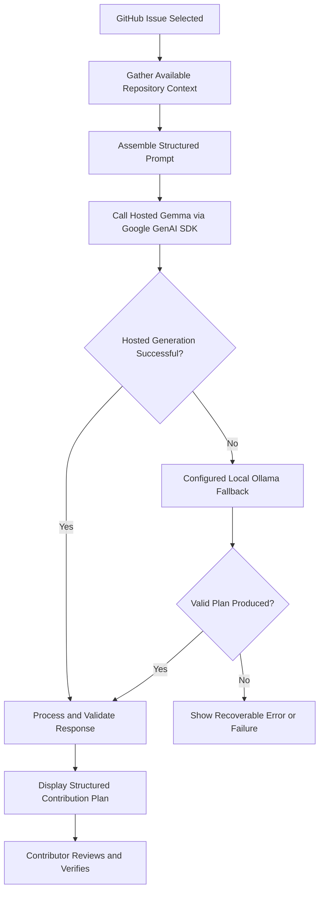
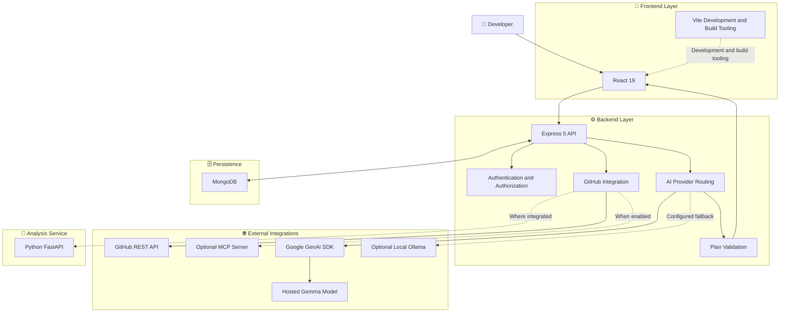

# 🚀 OpenOrbit

<div align="center">

### 🌍 Discover Open Source. Understand Code. Build Contributions.

**An AI-powered open-source contribution assistant that helps developers discover GitHub issues, understand unfamiliar repositories, generate structured implementation plans, and prepare high-quality Pull Requests.**

[](https://react.dev/)
[](https://vite.dev/)
[](https://nodejs.org/)
[](https://expressjs.com/)
[](https://www.mongodb.com/)
[](https://ai.google.dev/)
[](https://ollama.com/)

**From finding an issue to planning a contribution — all in one workspace.**

</div>

---

## 📖 Table of Contents

- [🌟 Overview](#-overview)
- [💡 The Problem](#-the-problem)
- [🎯 Our Vision](#-our-vision)
- [✨ Features](#-features)
- [🤖 AI Engineering with Gemma](#-ai-engineering-with-gemma)
- [🧠 Verified Facts vs AI Suggestions](#-verified-facts-vs-ai-suggestions)
- [🏗️ System Architecture](#️-system-architecture)
- [🔄 How OpenOrbit Works](#-how-openorbit-works)
- [🛠️ Technology Stack](#️-technology-stack)
- [📂 Project Structure](#-project-structure)
- [⚙️ Installation and Setup](#️-installation-and-setup)
- [🔐 Environment Configuration](#-environment-configuration)
- [🚀 Running OpenOrbit](#-running-openorbit)
- [🌐 API Reference](#-api-reference)
- [🧪 Testing and Quality Assurance](#-testing-and-quality-assurance)
- [🔒 Security](#-security)
- [⚠️ Limitations and Reliability](#️-limitations-and-reliability)
- [🗺️ Roadmap](#️-roadmap)
- [🤝 Contributing](#-contributing)
- [🐛 Reporting Issues](#-reporting-issues)
- [📄 License](#-license)
- [💚 Final Note](#-final-note)

---

## 🌟 Overview

Open-source development offers incredible opportunities to learn, collaborate, and build software used by people around the world. However, getting started in an unfamiliar repository can be challenging.

Developers must understand project conventions, navigate unfamiliar directories, investigate issue descriptions, identify relevant files, determine implementation strategies, and prepare tests before they can make a meaningful contribution.

**OpenOrbit is designed to reduce this initial friction.**

It combines GitHub issue discovery, repository inspection, AI-assisted contribution planning, saved issue management, and contribution preparation in a single developer-focused workspace.

Rather than generating generic coding advice, OpenOrbit aims to provide structured guidance informed by the repository and issue context available to the application.

### 🚀 What OpenOrbit Helps You Do

| Workflow | What it provides |
|---|---|
| 🔎 Discover | Find GitHub issues using search terms, languages, and issue labels. |
| 📂 Inspect | Explore repository metadata and available project context. |
| 🧠 Understand | Organize issue requirements and relevant repository information. |
| 🤖 Plan | Generate structured contribution roadmaps with Gemma. |
| ✅ Verify | Distinguish confirmed repository facts from AI suggestions where supported. |
| ⭐ Save | Maintain a personal contribution backlog. |
| 🎯 Explore | Discover additional issues based on saved-issue language signals. |
| 📝 Prepare | Generate conventional commit-style titles and Pull Request descriptions. |

> **Our principle:** AI should help developers understand and contribute to real codebases, not encourage them to trust unverified suggestions.

---

## 💡 The Problem

Contributing to an unfamiliar open-source repository often involves several challenges.

### 🔍 1. Finding the Right Issue

Repositories may contain hundreds or thousands of open issues. Beginners can struggle to identify suitable tasks based on their skills and interests.

### 🧩 2. Understanding the Codebase

Even when an issue is clearly described, developers may not know which files, functions, dependencies, or existing conventions are relevant.

### 🧠 3. Avoiding Unsupported AI Suggestions

A generic language-model response can suggest files that do not exist, overlook project architecture, or recommend changes without sufficient context.

### 🗂️ 4. Managing Contribution Opportunities

Interesting issues are easy to lose track of when developers explore multiple repositories and projects.

### 📝 5. Preparing a High-Quality Contribution

Developers need to think through implementation steps, acceptance criteria, risks, testing, commit conventions, and Pull Request documentation.

### 💚 The OpenOrbit Approach

OpenOrbit brings these activities into one workflow so contributors can spend less time organizing information and more time understanding, implementing, and verifying meaningful changes.

---

## 🎯 Our Vision

We want to make open-source contribution workflows more approachable for students, beginners, and experienced developers alike.

OpenOrbit is built around four principles:

- **Context over guesswork:** Use available repository evidence to inform recommendations.
- **Structure over generic advice:** Turn broad tasks into practical implementation plans.
- **Transparency over false certainty:** Separate confirmed facts from suggestions wherever possible.
- **Developer control over automation:** Keep developers responsible for reviewing and approving changes.

Our long-term direction is to make the journey from discovering an issue to preparing a verified contribution clearer and more efficient.

---

## ✨ Features

### 🔎 1. GitHub Issue Discovery

Explore real GitHub issues through the GitHub REST API.

**Capabilities include:**

- Search by keywords.
- Filter using supported issue labels.
- Discover beginner-friendly issues using labels such as `good-first-issue` and `help wanted`.
- Explore issues associated with different programming languages.
- Navigate paginated results.
- Account for GitHub API rate limits.
- Review issue information before deciding whether to contribute.

**Why it matters:** Developers can spend more time evaluating relevant contribution opportunities instead of manually searching across repositories.

### 📂 2. Repository Inspector

Understand the repository before writing code.

OpenOrbit can display available repository information, including:

- Repository name and description.
- Star and fork counts.
- License information.
- Default branch.
- Recent commits.
- Open Pull Requests.
- README and available repository context.

This information helps contributors evaluate the project and begin investigating the implementation.

### 🤖 3. AI Contribution Planner

The contribution planner uses the configured hosted Gemma model to transform issue details and available repository context into a structured engineering plan.

A plan can contain:

| Planning component | Purpose |
|---|---|
| 🎯 Target files | Identify candidate files to inspect or modify. |
| 🪜 Implementation steps | Break the work into ordered, manageable tasks. |
| 🔗 Dependencies | Highlight relevant dependencies and architectural relationships. |
| ⚠️ Risks | Identify assumptions, compatibility concerns, and potential pitfalls. |
| ✅ Acceptance criteria | Describe what a satisfactory implementation should achieve. |
| 🧪 Test plan | Identify checks that should be performed. |
| 📝 PR preparation | Suggest a commit-style title and structured PR description. |

The exact content depends on the available context and the model's response.

**Important:** AI-generated file targets remain suggestions unless confirmed by repository evidence.

### 🧠 4. Repository-Grounded AI Guidance

OpenOrbit is designed to give the model relevant context instead of relying solely on a short natural-language issue description.

Depending on the active workflow, that context may include:

- Issue title and description.
- Repository metadata.
- README content.
- Available file and directory information.
- Relevant repository context gathered through supported integrations.

Better context can help the model produce more relevant recommendations. It does not eliminate hallucinations or guarantee a correct implementation.

### ✅ 5. Verified Facts and AI Suggestions

OpenOrbit distinguishes confirmed repository information from AI-generated recommendations wherever supported.

- 🟢 **Verified facts:** Information supported by available repository evidence.
- 🟡 **AI suggestions:** Proposed changes or assumptions that still require confirmation.

This distinction is particularly important when a model recommends files, functions, dependencies, or implementation approaches.

### ⭐ 6. Saved Contribution Backlog

Keep track of interesting issues and personal contribution goals.

Supported backlog statuses include:

- `saved`
- `in_progress`
- `completed`
- `dismissed`

Saved issues can include personal implementation notes and progress information.

The backlog is stored in MongoDB and associated with the relevant user according to the application's implemented persistence and authorization rules.

### 🎯 7. Personalized Issue Recommendations

OpenOrbit can use language signals from saved issues to suggest additional beginner-friendly contribution opportunities.

The goal is to help developers discover related issues aligned with the technologies and interests reflected in their backlog.

Recommendations are suggestions, not endorsements or guarantees that an issue will be easy to solve.

### 📝 8. Pull Request Preparation

OpenOrbit supports preparation of contribution documentation, including:

- Conventional commit-style PR titles.
- Structured Markdown descriptions.
- Verification checklists.
- Implementation summaries.

For example, a suggested title might follow this convention:

```text
fix(issue-discovery): handle empty search results
```

A generated description can help summarize the motivation, implementation, and testing considerations.

**PR drafting and PR submission are separate capabilities.** Direct upstream branch creation, commits, and Pull Request submission are not represented as completed functionality in this README.

### 🔐 9. Authentication and Authorization

The project includes authentication and security-related mechanisms such as:

- Local account registration and login.
- HTTP-only JWT session cookies.
- Password hashing with `bcryptjs`.
- GitHub OAuth integration using PKCE.
- Encrypted storage for supported credentials.
- HMAC-SHA256 approval tokens for supported consequential actions.

The actual guarantees depend on route-level authorization, runtime configuration, and the implementation of each protected workflow.

### 🔌 10. Extensible Tool Integration

OpenOrbit includes a Model Context Protocol client that can communicate with a configured MCP server over standard input/output transport.

This integration can provide additional repository context or tool capabilities when enabled and correctly configured.

MCP availability depends on the configured server, credentials, network access, and supported tools.

### 🐍 11. Python Analysis Service

The project includes a Python FastAPI service intended to support analysis workflows where integrated.

The service can be developed independently from the main React and Express application, allowing more specialized analysis capabilities to be added over time.

Advanced AST analysis and call-graph analysis through a comprehensive Express-to-Python bridge remain roadmap work unless explicitly implemented and verified in the current codebase.

---

## 🤖 AI Engineering with Gemma

Gemma is central to OpenOrbit's AI-assisted contribution-planning approach.

### 🧠 What Is the Model Setup?

OpenOrbit's documented AI setup distinguishes the model from the API interface used to access it.

| Component | Role |
|---|---|
| 🧠 Gemma | The hosted model family used for contribution planning. |
| 🌐 Google GenAI SDK | The application interface used to send requests to the configured hosted model. |
| 🔑 Google AI Studio API key | The credential used for the configured hosted inference service. |
| 💻 Ollama | An optional runtime for local model inference. |
| 🏠 `gemma2:2b` | The documented local Ollama model. |

The hosted model documented for the current configuration is `gemma-4-26b-a4b-it`.

The local model documented for Ollama is `gemma2:2b`.

Model identifiers, API availability, and compatibility must be confirmed against the current provider configuration before deployment.

### 💡 Why Use Gemma for Contribution Planning?

OpenOrbit's use of Gemma is focused on a specific engineering problem: producing actionable guidance from repository and issue context.

#### 1. Context-Aware Planning

The model receives relevant context assembled by the application, helping it reason about the issue in relation to the available project information.

#### 2. Structured Engineering Output

Instead of returning only a conversational explanation, the planner aims to produce sections that map to a practical development workflow.

#### 3. Better Contributor Orientation

The plan helps contributors identify what to investigate first, what assumptions need checking, and which tests should be considered.

#### 4. Clearer Separation of Evidence and Suggestions

The application distinguishes repository information confirmed through available evidence from recommendations generated by the model.

#### 5. Flexible Inference Architecture

The hosted and optional local inference paths provide different deployment options. Local inference can be useful for experimentation or environments where local execution is preferred, provided the required model and runtime are available.

### 🔄 AI Request Lifecycle



This diagram illustrates the intended provider flow. The fallback path depends on the actual routing implementation and configuration; it is not a guarantee that every provider error will recover successfully.

### 🛡️ Reliability Principles

OpenOrbit's AI workflow should prioritize:

- Structured output validation.
- Clear error handling for provider failures.
- Explicit separation of repository facts and AI suggestions.
- Sensible handling of missing or incomplete context.
- Review by the developer before code changes are made.
- No assumption that a successful HTTP response automatically means the generated plan is correct.

AI assistance is most useful when treated as a planning partner rather than an unquestionable source of truth.

---

## 🧠 Verified Facts vs. AI Suggestions

One of OpenOrbit's important design principles is transparency.

A repository-grounded contribution assistant should not present every model-generated statement as if it were verified from source code.

### Example

Suppose an issue requests a change to repository authentication.

| Information | Classification |
|---|---|
| A file path confirmed by repository inspection | Verified repository fact |
| A function observed in inspected source code | Verified repository fact |
| A proposed new helper function | AI suggestion |
| A claim about a dependency not found in the available context | Unverified assumption |
| A suggested test that has not been executed | Recommended verification step |

These classifications depend on the evidence actually available to the application.

A model may still misunderstand verified context, and a file marked as verified does not imply that the proposed modification is correct. Developers must review the actual implementation.

---

## 🏗️ System Architecture

OpenOrbit uses a multi-component architecture combining a web frontend, an Express backend, external GitHub integration, AI inference, persistent storage, and an optional Python analysis service.

### 🧩 High-Level Architecture



### 🧱 Architecture Responsibilities

| Component | Responsibility |
|---|---|
| 🎨 React + Vite | User interface, interaction, and frontend build tooling. |
| ⚙️ Express | API routing, orchestration, and backend integration. |
| 🐙 GitHub REST API | Issue discovery and repository information. |
| 🔌 MCP client | Optional external tool integration. |
| 🤖 Hosted Gemma | AI-assisted contribution planning. |
| 💻 Ollama | Optional local inference path. |
| 🗄️ MongoDB | Persistent user and saved-issue data. |
| 🐍 FastAPI | Supported Python-based analysis workflows. |

Not every service participates in every request. The actual execution path depends on the implemented integration and configuration.

---

## 🔄 How OpenOrbit Works

### Step 1 — Discover an Issue 🔎

Search GitHub for an issue that matches your interests, preferred language, or contribution goals.

### Step 2 — Inspect the Repository 📂

Review repository information and the available project context before deciding how to approach the issue.

### Step 3 — Generate a Contribution Plan 🤖

OpenOrbit sends the prepared context to the configured hosted Gemma model through Google's GenAI interface.

### Step 4 — Review the Plan 🧠

Examine suggested files, implementation steps, risks, acceptance criteria, and test recommendations.

### Step 5 — Verify the Evidence ✅

Confirm relevant files and assumptions against the actual repository. Do not treat unverified suggestions as facts.

### Step 6 — Save and Track Progress ⭐

Keep the issue in your personal backlog and update its progress as you work.

### Step 7 — Prepare the Contribution 📝

Use the available PR drafting workflow to prepare a conventional commit-style title, description, and verification checklist.

### Step 8 — Test and Review 🧪

Run the relevant checks, review the actual code changes, and follow the target repository's contribution guidelines.

---

## 🛠️ Technology Stack

### 🎨 Frontend

- **React 19** — Component-based user interface.
- **Vite 8** — Development server and production bundler.
- **Vanilla CSS** — Custom styling and warm-neutral design system.
- **oxlint** — Static code analysis.

### ⚙️ Backend

- **Node.js 20+** — JavaScript runtime.
- **Express 5** — HTTP API and backend orchestration.
- **cookie-parser** — Cookie parsing middleware.
- **CORS** — Cross-origin request configuration.
- **dotenv** — Environment configuration.

### 🗄️ Database

- **MongoDB** — Persistent document database.
- **Mongoose 9** — Object document modeling.

### 🤖 AI and Model Integration

- **Google GenAI SDK (`@google/genai`)** — Hosted model access.
- **Gemma** — Configured hosted model for contribution planning.
- **Ollama** — Optional local inference runtime.
- **`gemma2:2b`** — Documented local model.
- **Structured output validation** — Validation of generated contribution plans.

### 🔌 Tooling and Analysis

- **Model Context Protocol SDK** — Optional tool integration.
- **Python 3.11+** — Python analysis service runtime.
- **FastAPI** — Python HTTP service framework.
- **Pydantic v2** — Data validation.
- **Uvicorn** — ASGI server.

### 🔐 Authentication and Security

- HTTP-only JWT cookies.
- `bcryptjs` password hashing.
- GitHub OAuth with PKCE.
- AES-256-GCM encryption for supported stored credentials.
- HMAC-SHA256 approval tokens for supported consequential operations.

---

## 📂 Project Structure

The following is a high-level representation of the documented application architecture. Confirm exact filenames and subdirectories against the current repository.

```text
OpenOrbit/
│
├── client/                         # 🎨 React + Vite frontend
│   ├── src/
│   │   ├── components/             # Reusable UI components
│   │   ├── pages/                  # Application screens
│   │   ├── services/               # Frontend API integration
│   │   └── ...                     # Existing frontend modules
│   └── package.json
│
├── server/                         # ⚙️ Express backend
│   ├── src/
│   │   ├── routes/                 # API routes
│   │   ├── controllers/            # Request handlers
│   │   ├── services/               # Business and integration services
│   │   ├── middleware/             # Middleware and authorization
│   │   └── tests/                  # Backend tests
│   ├── .env.example                # Environment template, if present
│   └── package.json
│
├── python-ai-service/              # 🐍 Python analysis service
│   ├── app/
│   │   └── main.py                 # FastAPI entry point
│   └── requirements.txt
│
├── package.json                    # Root scripts and dependencies
└── README.md                       # Project documentation
```

This is an illustrative structure, not an exhaustive inventory of every file.

---

## ⚙️ Installation and Setup

### 📋 Prerequisites

Before running OpenOrbit, install:

- [Node.js](https://nodejs.org/) — Version 20 or later.
- [npm](https://www.npmjs.com/) — Version 10 or later.
- [MongoDB](https://www.mongodb.com/) — Local installation or Atlas.
- [Google AI Studio](https://aistudio.google.com/) — For hosted Gemma inference.
- [Ollama](https://ollama.com/) — Optional local inference.
- [Python](https://www.python.org/) — Version 3.11 or later for the Python service.

### 1️⃣ Clone the Repository

```bash
git clone https://github.com/Neeraj-code-beep/OpenOrbit.git
cd OpenOrbit
```

### 2️⃣ Install Dependencies

```bash
npm install
npm --prefix server install
npm --prefix client install
```

### 3️⃣ Create the Environment File

```bash
cp server/.env.example server/.env
```

For Windows PowerShell:

```powershell
Copy-Item server/.env.example server/.env
```

If the example file does not exist in your checkout, create the local environment file using the configuration expected by the current backend.

### 4️⃣ Configure MongoDB

For a local MongoDB instance, the documented development URI is:

```env
MONGODB_URI=mongodb://127.0.0.1:27017/openorbit
```

Alternatively, configure your MongoDB Atlas connection string.

Ensure the database is reachable before testing persistence-dependent features.

### 5️⃣ Configure Hosted Gemma Inference

Obtain an API key through [Google AI Studio](https://aistudio.google.com/).

Configure the variable names expected by the current backend:

```env
GEMINI_API_KEY=your_google_ai_studio_api_key
GEMINI_MODEL=gemma-4-26b-a4b-it
```

These are the documented configuration names for this project. Confirm that the actual provider code supports the configured model ID and reads these exact variables.

The presence of `GEMINI` in a variable name refers to the existing integration configuration; it does not mean that the configured model is necessarily from the Gemini model family.

### 6️⃣ Configure Optional Local Inference

Install Ollama, then download the local model:

```bash
ollama pull gemma2:2b
```

Configure the local endpoint and model if supported by your current provider implementation:

```env
OLLAMA_HOST=http://127.0.0.1:11434
OLLAMA_MODEL=gemma2:2b
```

Make sure Ollama is running before testing local inference.

### 7️⃣ Configure GitHub Integration

GitHub issue discovery and repository inspection rely on the configured GitHub integration.

If the application uses GitHub OAuth, create and configure the relevant GitHub App credentials and callback URL.

Example configuration:

```env
GITHUB_APP_CLIENT_ID=your_github_app_client_id
GITHUB_APP_CLIENT_SECRET=your_github_app_client_secret
GITHUB_APP_CALLBACK_URL=http://localhost:5000/api/v1/auth/github/callback
```

An optional GitHub personal access token may also be used for supported API operations.

Never commit actual OAuth credentials or personal access tokens.

### 8️⃣ Configure Authentication Secrets

Configure a strong JWT secret and a cryptographically secure encryption key when required.

The encryption key used for AES-256-GCM should be 32 random bytes encoded as 64 hexadecimal characters.

Generate a key using Node.js:

```bash
node -e "console.log(require('node:crypto').randomBytes(32).toString('hex'))"
```

Use the variable names expected by the current application.

---

## 🔐 Environment Configuration Reference

The following table summarizes the documented configuration. Exact requirements and defaults should be verified against the current `.env.example` and backend implementation.

| Variable | Purpose | Typical value |
|---|---|---|
| `PORT` | Express port | `5000` |
| `NODE_ENV` | Runtime environment | `development` |
| `CORS_ORIGIN` | Allowed frontend origin | `http://localhost:5173` |
| `CLIENT_ORIGIN` | Frontend base URL | `http://localhost:5173` |
| `MONGODB_URI` | MongoDB connection | Local URI or Atlas URI |
| `JWT_SECRET` | JWT signing secret | Strong random secret |
| `JWT_EXPIRES_IN` | JWT expiration | `1d` |
| `GITHUB_TOKEN` | Optional GitHub PAT | Local secret |
| `AI_PROVIDER` | AI provider selection | According to implementation |
| `GEMINI_API_KEY` | Hosted GenAI credential | Google AI Studio key |
| `GEMINI_MODEL` | Hosted model ID | Configured Gemma model |
| `OLLAMA_HOST` | Local Ollama endpoint | `http://127.0.0.1:11434` |
| `OLLAMA_MODEL` | Local model ID | `gemma2:2b` |
| `MCP_ENABLED` | MCP feature toggle | `false` |
| `MCP_SERVER_COMMAND` | MCP process command | `npx` |
| `MCP_SERVER_ARGS` | MCP process arguments | JSON argument array |
| `GITHUB_APP_CLIENT_ID` | OAuth client ID | GitHub App ID |
| `GITHUB_APP_CLIENT_SECRET` | OAuth client secret | Local secret |
| `GITHUB_APP_CALLBACK_URL` | OAuth callback | Local callback URL |
| `GITHUB_ENCRYPTION_KEY` | Encryption key | 64-character hex string |

> 🔒 Keep all real credentials in local environment variables or an appropriate secrets manager. Example values in documentation must never be replaced with production secrets.

---

## 🚀 Running OpenOrbit

### Start the Main Application

From the repository root:

```bash
npm run dev
```

The documented default development URLs are:

| Service | URL |
|---|---|
| 🎨 Frontend | `http://localhost:5173` |
| ⚙️ Backend | `http://localhost:5000` |
| ❤️ Healthcheck | `http://localhost:5000/api/health` |

### Start the Python Service Separately

If you need the Python analysis service:

```bash
cd python-ai-service
pip install -r requirements.txt
uvicorn app.main:app --host 127.0.0.1 --port 8000 --reload
```

The Express-to-Python connection must be configured for the relevant analysis workflows.

### Verify the Application

After starting the services:

1. Open the frontend in your browser.
2. Confirm the backend starts successfully.
3. Check the health endpoint.
4. Test GitHub issue discovery.
5. Inspect a repository.
6. Generate a contribution plan.
7. Verify the model provider and fallback configuration.
8. Test saved issues and other persistence-dependent features.
9. Review the browser console and backend logs for errors.

---

## 🌐 API Reference

The following endpoints reflect the API surface documented for OpenOrbit. Confirm the active route mounts and authentication middleware before treating this table as an exhaustive API contract.

### ❤️ Health

| Method | Endpoint | Description |
|---|---|---|
| `GET` | `/api/health` | Inspect application health and configured service availability. |

### 🔐 Authentication

| Method | Endpoint | Description |
|---|---|---|
| `POST` | `/api/v1/auth/register` | Register a local account. |
| `POST` | `/api/v1/auth/login` | Authenticate and establish a session. |
| `GET` | `/api/v1/auth/me` | Retrieve the current authenticated user. |
| `POST` | `/api/v1/auth/reauth` | Request a reauthentication ticket for sensitive operations. |
| `GET` | `/api/v1/auth/github` | Start GitHub OAuth authorization. |
| `GET` | `/api/v1/auth/github/callback` | Handle the OAuth callback. |
| `DELETE` | `/api/v1/auth/github` | Disconnect a linked GitHub account. |
| `POST` | `/api/v1/auth/logout` | Clear the session cookie. |

### 🐙 GitHub Integration

| Method | Endpoint | Description |
|---|---|---|
| `GET` | `/api/github/issues` | Search issues using supported filters. |
| `GET` | `/api/github/repositories/:owner/:repo` | Inspect repository metadata. |
| `GET` | `/api/github/repositories/:owner/:repo/issues/:number` | Retrieve issue details. |
| `GET` | `/api/github/repositories/:owner/:repo/pulls` | Retrieve recent Pull Requests. |
| `GET` | `/api/github/repositories/:owner/:repo/commits` | Retrieve recent commits. |
| `GET` | `/api/github/users/:username/activity` | Retrieve public user activity. |
| `GET` | `/api/github/user/repos` | List repositories for the authenticated GitHub account. |

### 🤖 AI and Contribution Planning

| Method | Endpoint | Description |
|---|---|---|
| `GET` | `/api/ai/status` | Inspect AI provider status. |
| `POST` | `/api/ai/contribution-plan` | Generate a structured contribution roadmap. |
| `POST` | `/api/contributions/validate-plan` | Validate a contribution plan. |
| `POST` | `/api/contributions/pr-description` | Generate a conventional commit-style title and PR description. |

### ⭐ Saved Issues

| Method | Endpoint | Description |
|---|---|---|
| `GET` | `/api/v1/saved-issues` | Retrieve the user's saved issues. |
| `POST` | `/api/v1/saved-issues` | Save an issue with notes and an initial status. |
| `PATCH` | `/api/v1/saved-issues/:id` | Update an issue's status or notes. |
| `DELETE` | `/api/v1/saved-issues/:id` | Remove a saved issue. |

### 🎯 Recommendations and MCP

| Method | Endpoint | Description |
|---|---|---|
| `GET` | `/api/v1/recommendations/issues` | Retrieve personalized issue recommendations. |
| `GET` | `/api/mcp/status` | Inspect MCP connection status and discovered tools. |

**Authentication note:** The public, optional, and protected classifications depend on the actual route middleware. Verify these details in the backend source before publishing a formal API contract.

---

## 🧪 Testing and Quality Assurance

OpenOrbit uses automated tests and code-quality checks to help detect regressions.

### 🧩 Backend Tests

Run the configured test suite:

```bash
npm test
```

Documented test coverage includes:

- 🐙 GitHub REST API data mapping.
- ⚡ In-memory sliding-window rate limiting and cleanup.
- 🤖 AI contribution-plan JSON validation.
- 📝 PR description generation.
- 🔐 HMAC-SHA256 approval-token signing and verification.

### 🧹 Frontend Linting

```bash
npm run lint
```

### 🏗️ Production Build

```bash
npm run build
```

### ✅ Recommended Verification Checklist

- [ ] Frontend starts without runtime errors.
- [ ] Backend health endpoint responds correctly.
- [ ] GitHub issue discovery returns expected results.
- [ ] Repository inspection displays available information.
- [ ] Hosted Gemma inference works with the configured model.
- [ ] Local Ollama inference works when enabled.
- [ ] Provider failures are handled safely.
- [ ] Generated contribution plans are validated.
- [ ] Verified facts and AI suggestions remain distinguishable.
- [ ] Saved issues persist correctly.
- [ ] Authentication and authorization behave as expected.
- [ ] Linting, tests, and production build pass.

Only mark checks as passing after running them against the current checkout.

---

## 🔒 Security

Security is important because OpenOrbit interacts with user accounts, external APIs, repository information, and AI-generated content.

### 🔑 Authentication and Credentials

- Use HTTP-only cookies for supported session flows.
- Hash local account passwords.
- Apply PKCE to the supported GitHub OAuth flow.
- Protect stored credentials with the configured encryption mechanism.
- Keep JWT secrets, OAuth secrets, API keys, and encryption keys outside version control.

### 🛡️ Authorization

- Enforce authentication for protected user-specific operations.
- Validate ownership before accessing or modifying saved user data.
- Require appropriate authorization for consequential operations.
- Do not assume that generating an approval token automatically makes every possible mutation safe.

### 🧠 AI Safety

- Treat repository content and issue descriptions as untrusted input.
- Validate structured model output.
- Handle provider failures and malformed responses.
- Distinguish verified repository information from suggestions.
- Never execute AI-generated instructions without appropriate validation and review.

### 🔐 Deployment

- Use HTTPS in production.
- Configure CORS for trusted frontend origins.
- Keep dependencies updated.
- Avoid logging secrets or sensitive authentication data.
- Review route authorization, rate limiting, error handling, and credential storage before production deployment.

These are security principles and documented mechanisms; actual security guarantees depend on the implementation and deployment configuration.

---

## ⚠️ Limitations and Reliability

OpenOrbit is designed to assist contributors, but several factors can affect the output.

### 🤖 AI Limitations

AI-generated plans may contain incorrect assumptions, incomplete steps, or recommendations that do not fit the repository.

Always inspect the actual code and verify suggested files before implementation.

### 🌐 External Service Dependencies

GitHub API availability, provider quotas, network connectivity, and model-service errors may affect issue discovery and hosted inference.

### 💻 Optional Local Inference

Local fallback requires a working Ollama installation, a downloaded model, and a correctly configured backend. It should not be assumed to recover from every hosted-provider failure.

### 🧪 Verification Is Essential

A generated plan is not proof that an implementation works. Run tests, review changes, and follow the target repository's contribution guidelines.

### 🚧 Planned Features

Distributed rate limiting, automated token refresh, direct in-app PR submission, and continuous integration must not be assumed available unless implemented and verified in the current version.

---

## 🗺️ Roadmap

The following are **planned enhancements**, not claims that the functionality is already implemented.

### 🔄 1. Automated Token Refresh

Introduce a background process for refreshing expiring GitHub App user access tokens using supported refresh-token flows.

Planned considerations:

- Secure token storage.
- Expiration tracking.
- Refresh failure handling.
- Safe reauthentication when necessary.

### 🐍 2. Deeper Python Analysis Bridge

Expand Express-to-FastAPI integration for more advanced repository analysis.

Potential improvements:

- Abstract Syntax Tree (AST) analysis.
- Call-graph exploration.
- More precise code-context extraction.
- Improved source-file relationships.

### ⚡ 3. Distributed Rate Limiting

Introduce a shared Redis-backed sliding-window store for multi-instance backend deployments.

Potential benefits:

- Consistent limits across instances.
- Shared rate-limit state.
- Better horizontal scalability.
- Centralized rate-limit tracking.

### 🚀 4. In-App Pull Request Submission

Explore an end-to-end contribution workflow for creating branches, committing changes, and opening upstream Pull Requests.

Planned safeguards:

- Explicit user approval.
- Verified authorization.
- Clear summaries of proposed changes.
- Validation before consequential actions.
- Transparent success and failure reporting.

Direct upstream PR submission is a planned enhancement, not a completed capability claimed by this README.

### 🔁 5. Continuous Integration

Add GitHub Actions workflows for:

- Automated linting.
- Backend tests.
- Frontend production builds.
- Python service tests where appropriate.
- Container builds.
- Pull Request quality checks.

### 🧠 6. Improved Repository Grounding

Improve how relevant repository context is gathered and validated before AI planning.

Potential improvements include more precise file selection, better traceability, and clearer handling of missing evidence.

### 📊 7. AI Reliability and Observability

Improve provider health reporting, timeout handling, fallback visibility, structured error diagnostics, and monitoring of generation failures.

### 🎯 8. Contribution Workflow Improvements

Continue improving contribution tracking, plan review, testing guidance, and the experience of moving from an issue to a verified contribution.

---

## 🤝 Contributing

We welcome contributions, bug reports, feature requests, and documentation improvements! 💚

### 🚀 Getting Started

1. 🍴 Fork the repository.
2. 📥 Clone your fork.
3. 🌿 Create a focused feature branch.
4. 🛠️ Implement a small, well-scoped change.
5. 🧪 Run relevant tests and quality checks.
6. 📝 Write a clear commit message.
7. 🚀 Open a Pull Request describing your change.

### 📋 Contribution Guidelines

- Follow existing project conventions.
- Keep changes focused and easy to review.
- Include tests where appropriate.
- Update documentation when behavior changes.
- Never commit secrets or credentials.
- Clearly explain assumptions and limitations.
- Avoid claiming tests pass unless they have actually been run.

### 💡 Ideas for Contributions

- Improve issue discovery and filtering.
- Improve repository-context handling.
- Add tests for AI provider failure scenarios.
- Improve accessibility and responsive UI behavior.
- Refine documentation and onboarding.
- Improve structured plan validation.
- Help develop future roadmap features.

Before beginning substantial work, review the repository's current contribution guidelines and open issues.

---

## 🐛 Reporting Issues

Found a bug or have an improvement in mind?

When opening an issue, include as much relevant information as possible:

- 📝 A clear description of the problem.
- 🔁 Steps to reproduce it.
- 🎯 Expected behavior.
- ❌ Actual behavior.
- 🖥️ Relevant environment details.
- 📋 Relevant logs or error messages, with secrets removed.

For AI-related issues, it can also help to identify the configured provider, model, and whether the failure occurred during context retrieval, generation, or response validation.

Never publish API keys, OAuth credentials, session tokens, or other sensitive information in issue reports.

---

## 📄 License

Please check the repository's `LICENSE` file for the applicable license and usage terms.

Do not assume a license merely because the repository is publicly available.

---

## 🙌 Acknowledgements

OpenOrbit builds on the broader open-source ecosystem and the technologies that make developer tools possible.

- 💚 [React](https://react.dev/) and [Vite](https://vite.dev/) for frontend development.
- ⚙️ [Node.js](https://nodejs.org/) and [Express](https://expressjs.com/) for backend development.
- 🗄️ [MongoDB](https://www.mongodb.com/) for persistent data storage.
- 🤖 [Google AI for Developers](https://ai.google.dev/) for hosted model integration.
- 💻 [Ollama](https://ollama.com/) for local model execution.
- 🐙 [GitHub](https://github.com/) for the open-source ecosystem and API integration.
- 🔌 [Model Context Protocol](https://modelcontextprotocol.io/) for extensible tool integration.
- 🐍 [FastAPI](https://fastapi.tiangolo.com/) for Python service development.

OpenOrbit is intended to help more developers discover opportunities, learn from real codebases, and contribute confidently.

---

<div align="center">

## 💚 OpenOrbit

### Discover Issues. Understand Code. Plan Contributions. Build in the Open. 🚀

**Making open-source contribution workflows clearer, one issue at a time.**

⭐ If you find OpenOrbit useful, consider starring the repository and sharing feedback.

</div>
