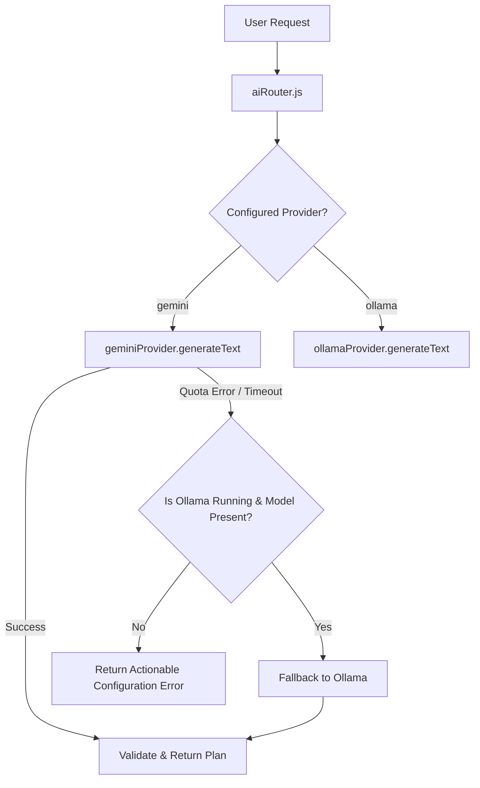

# AI Routing & Fallback Mechanics

OpenOrbit implements a provider-neutral AI architecture orchestrated by `server/src/services/ai/ai.router.js`.

## Supported Providers

| Provider | Type | SDK / Transport | Primary Use Case |
| :--- | :--- | :--- | :--- |
| **Google Gemini / Gemma** | Cloud Hosted | `@google/genai` (Official) | High accuracy, multi-turn reasoning, and instant responses. |
| **Ollama** | Local Offline | Direct HTTP (`127.0.0.1:11434`) | Privacy-first environments, air-gapped coding, zero API costs. |

---

## Configuration

In `.env`:
```ini
# Primary Provider
AI_PROVIDER=gemini # or 'ollama'

# Gemini Settings
GEMINI_API_KEY=your_key_here
GEMINI_MODEL=gemini-2.5-flash

# Ollama Settings
OLLAMA_HOST=http://127.0.0.1:11434
OLLAMA_MODEL=llama3:latest
```

---

## Fallback Logic



If the primary provider fails due to rate limits or connection loss, the AI Router automatically checks whether the alternate provider is healthy. If healthy, it seamlessly delegates the prompt and logs the fallback event without crashing the user session.
